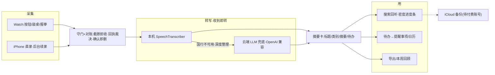

# DayTap

**组员先读 → [`docs/onboarding-teammates.md`](docs/onboarding-teammates.md)**

> DayTap · 腕上日录:手表上按一下,回到手机时,它已经是文字、摘要和待办。

**功能介绍(用户视角完整版)→ [`docs/product-intro.md`](docs/product-intro.md)**

**没有 TestFlight,也没有可点的安装包,只能 Mac + Xcode 侧载**(无 `.xcworkspace`,双击 `apps/DayTap/DayTap.xcodeproj` 即开):

```bash
git clone --depth 1 https://github.com/guanlili/DayTap.git
```

装机步骤与环境:[`docs/dev-setup.md`](docs/dev-setup.md) · 只装手表:[`docs/teammate-watch-sideload.md`](docs/teammate-watch-sideload.md) · 手表工程细节:[`docs/daytap-watch-app.md`](docs/daytap-watch-app.md)

English blurb: **DayTap** — wrist-first capture → on-device transcription, summary & action items on iPhone, with any OpenAI-compatible cloud LLM as fallback. No TestFlight; sideload with Xcode.

---

## 为什么做

很多人想把 Apple Watch 当随身 AI 硬件。DayTap 的切法更稳:先把「按一下 → 回手机时已是可检索的文字、摘要和待办」做到语音备忘录级别的顺滑,AI 部分(摘要/分类/待办/兜底转写)可配可换、关掉也能用。语料 → 决策卡 / PPT 的 Agent 路线留在 `pipeline/`(stub)。

---

## 现在能做什么

### 手表(Apple Watch Series 11 真机在用)

- **三种启停**:红色大按钮 / 敲桌两下 / 握拳(AssistiveTouch 手势,需绑定快捷指令)
- 主屏只剩一颗按钮;待传、失败、传输计数都在左上角标的半屏 sheet 里
- **确认即删**:手机回执到达后即删表上原件,存储不留尾巴;未确认的绝不删
- 表盘小组件(WidgetKit)一键开录

### 手机(iPhone 17 真机在用)

- **自动转全文**:音频一到就转(iOS 26 本机 SpeechTranscriber,时间戳分段;插电 / 电量≥50% / 前台时消费队列)
- **摘要卡**:标题 / 类别 / 摘要 / 待办一次生成,类别可手动纠偏
- **待办 2.0**:行内勾选落库,一键进系统提醒事项 / 日历(EventKit),AI 识别「周五」这类截止说法
- **检索回听**:搜标题与全文,命中行高亮跳播、全文页点句跳播 + 跟读滚动
- **播放**:拖动定位、1x / 1.5x / 2x 倍速、跳静音、**语义密度着色进度条**(哪段是话、哪段是静音一眼可见)
- 手机也能直接录(退后台 / 锁屏续录,对齐语音备忘录)
- 本周回顾、导出 Markdown / 纯文本 / JSON、最近删除 30 天、批量管理、按天 + 按类别浏览

### AI(可选,不配也能用)

- 国行 iPhone 无 Apple Intelligence → **本机优先、云端兜底**瀑布;失败状态行内可见,不静默
- **LLM 配置中心**:智谱 / 火山方舟 / DeepSeek / Kimi / 通义 / OpenAI 兼容,支持自定义 base_url 与模型名;连通性测试「先保存再测」,结果语义化着色
- **「关于我」词表**:可选背景段,给模型人名 / 术语写法线索,纠专名
- 设置页**「数据去向」清单**:本机边界 / AI 出网边界 / iCloud,一屏明文

### 数据与传输

- 传输**守门 + 对账**:截断件拒收不回执、回执丢失自动重传裁决,坏数据不进库
- 收件侧可解码校验;索引 `index.json` 带 `.bak` 轮转恢复
- **iCloud 备份引擎已就绪**(CloudKit 双表 / 墓碑同步 / 换机恢复),免费开发者账号开不了该能力,现泊车待付费账号一键启用

---

## 架构



---

## 开发

- 环境:Xcode 27(本机 27.2 验证)/ 部署目标 iOS 26.0、watchOS 10.0;个人免费 Apple ID 签名即可(EventKit 可用,CloudKit 需付费团队)
- 单测:`cd apps/DayTap/DayTapCore && swift test`(纯逻辑 22 例,秒级)
- 冒烟:`scripts/build-smoke.sh`(前置 swift test 门)、`scripts/env-check.sh`
- 工程为 Xcode 16 文件系统同步组形态:**加文件不碰 pbxproj**;`Shared/AudioCapture.swift` 跨 target 例外集已挂

## 仓库结构

```
DayTap/
├── apps/DayTap/
│   ├── DayTap.xcodeproj     # 双击打开;无 .xcworkspace
│   ├── DayTap/              # iPhone App
│   ├── DayTapWatch/         # Watch App
│   ├── DayTapWidget/        # 表盘小组件
│   ├── DayTapCore/          # 共享纯逻辑 SPM 包(swift test 直跑)
│   ├── Shared/              # 跨端共享源码(AudioCapture 等)
│   └── Config/              # Info.plist ×3 + entitlements
├── docs/                    # 装机/工程/口径文档
├── scripts/                 # build-smoke / env-check
├── pipeline/                # 早期语料→Agent 流水线 stub(ingest/transcribe/corpus/agent)
├── corpus/examples/         # 示例转写 + 决策卡
└── blog/                    # 开发记录
```

---

## 状态(2026-11-14)

- [x] 真机闭环:Watch 录 → 传输 → iPhone 自动转写 → 摘要 / 待办(iPhone 17 + Watch S11 双端长期在用)
- [x] 传输截断战役收官:守门 / 对账 / 让位 / 解拦四件套,坏数据不进库、不静默丢件
- [x] DayTapCore 本地包 swift test;工程迁文件系统同步组;RecordingListView 拆分等工程卫生
- [x] LLM 配置中心 + 国行云端兜底(真机验证)
- [x] 待办 2.0 / 本周回顾 / 导出多样化 / 密度进度条 / 关于我词表 / 数据去向清单
- [ ] iCloud 备份:引擎就绪,等付费开发者账号翻闸(泊车步骤在 issue #56)
- [ ] TestFlight 上线链路(队友侧载是当前最大安装痛点)
- [ ] 长录音 digest 截断修复(#68)/ 待办承诺方向(#70):待需求评审
- [ ] App Store:未提交审核,不要说已经能上架

v2 候选池:降噪 / 自定义类别 · 多标签 / 日历视图 / 音频 zip 导出 / Action Button · 控制中心一键录音 / 每功能各配模型

---

## 重要约束(诚实版)

- 腕上麦克风是第一方 **DayTap Watch App**,不依赖系统语音备忘录或第三方录音 App
- **不做全天候无感录音**:手表录音是前台行为;手机录退后台续录仅限「正在录的那条」,对齐语音备忘录
- 手表不连接得到;想进得到工作流,音频到 iPhone 后走系统分享面板(App 本身不集成、也不依赖得到)
- 国行 iPhone 官方无 Apple Intelligence(口径:随 iOS 27.3 推送);深度整理依赖可选的云端 LLM,key 存 Keychain
- **音频永不外发**:出设备的只有转写文字与可选的「关于我」段;iCloud 备份可关或仅备文字
- 本仓库不含任何 API Key;勿提交 `.env`
- 模拟器传文件不可靠,不要当成功;验收以真机为准

---

## 更多文档

- 功能介绍(用户视角完整版):[`docs/product-intro.md`](docs/product-intro.md)
- 架构与数据流(早期版):[`docs/architecture.md`](docs/architecture.md)
- 手表工程:打开 / 签名 / 传输 / 限制 → [`docs/daytap-watch-app.md`](docs/daytap-watch-app.md)
- 早期 MVP 路线档案(得到双轨 Track 0/1/2、方案 A/B、演示脚本、公众号提纲):`docs/tech-path.md`、`docs/scheme-b-apple-native.md`、`docs/watch-two-tracks.md`、`docs/mvp-demo-script.md` 等,口径以本 README 为准

## 贡献 How to contribute

1. 先开 issue 对齐再动手;commit message 末尾带 issue 号(`#N`)
2. UI 批次交付前过 apple-design + swiftui-pro 双审查
3. 真实隐私数据不进仓库(`corpus/daily/` 已 gitignore);示例放 `corpus/examples/`

## License

[MIT](LICENSE) © 2026 Chris Cui (崔莹) and contributors
