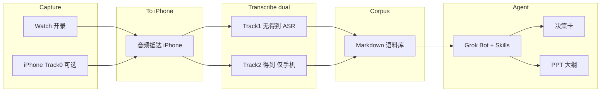

# DayTap

**组员先读 → [`docs/onboarding-teammates.md`](docs/onboarding-teammates.md)**

没有 TestFlight，也没有可点的安装包。只能 **Mac + Xcode 侧载**。Watch MVP 在分支 `cursor/daytap-watch-app-60a0`（GitHub `main` 与这一支是同一版）/ [PR #1](https://cursor.com/codebase/chris-cui/DayTap/pull/1)。装机用浅克隆，不要拉全历史：`git clone --depth 1 --branch cursor/daytap-watch-app-60a0 https://github.com/flicy/DayTap.git`。Origin 备用：`git clone --depth 1 --branch cursor/daytap-watch-app-60a0 https://origin.cursor.com/chris-cui/DayTap.git`。只看装机步骤：[`docs/teammate-watch-sideload.md`](docs/teammate-watch-sideload.md)。

> DayTap · 腕上日录 / 按需录音 → Agent

> **Watch 可开录 · iPhone 收音频 · 双轨转写（无得到 / 有得到）· 语料库 · Grok Bot 决策卡 / PPT**  
> 硬约束：腕上麦克风是 **DayTap Watch App**（不是系统语音备忘录，不是第三方录音机）。Watch **无**得到大脑，也绝不连接得到。音频到 iPhone 之后 Track 1 / Track 2 都有效。Track 0 手机录是没装上或长课时的保底。还不能从 App Store 安装。

English blurb: **DayTap** — wrist-first or phone-primary on-demand capture → dual ASR tracks (Apple/Feishu/Obsidian **without** Dedao, or import into Dedao **on iPhone only**) → document corpus → Grok Bot decision cards / PPT outlines.

---

## 愿景 Vision

很多人想把 **Apple Watch 当成随身 AI 硬件**：录音、推送、指挥 Personal Agent。  
本项目采用更稳的产品切法：

| 角色 | 职责 |
|------|------|
| **Apple Watch** | **DayTap Watch App**：前台一键开录/停止，本地保存，再用 WatchConnectivity 把 m4a 传到配对 iPhone。表上无得到 |
| **iPhone** | DayTap 收文件、列出、分享；录音到位**自动转全文**（本机转写，行内预览、一键复制），列表按天分组、按类别自动归类筛选。Track 2 才把文件交给得到；Track 1 把同一文件交给飞书/系统转写。也可 **Track 0** 手机主录 |
| **得到（得到大脑）** | **仅 iPhone**：Track 2 / 方案 A 转写 |
| **Track 1 ASR** | 无得到：Mac 系统转写 / 快捷指令 / 飞书妙记 / Obsidian 文字落点 |
| **本地语料库** | 手机端一键导出 Markdown（按天/类别/摘要/待办/全文），按日/场/人沉淀 |
| **Grok Bot + Skills** | 读语料 → 决策卡 / PPT 大纲 |

**不做**：宣称 Watch 全天候无中断录音是系统默认能力（见约束）。  
**要做**：周五（2026-11-06，Asia/Shanghai）可演示的最短闭环，并开源骨架。

---

## 架构 Architecture



---

## 数据流 Data flow（MVP）

1. **按需开录**（DayTap Watch App，或 Track 0 手机主录）
2. **音频到 iPhone**：手表 `WCSession.transferFile` → iPhone DayTap 的文稿目录（见 `docs/daytap-watch-app.md`）→ 需要进流水线时再登记到 `pipeline/ingest/`
3. **转写**：Track 1 无得到；Track 2 在 iPhone 上分享/导入得到（见 `docs/watch-two-tracks.md`）
4. **沉淀语料** → `corpus/`（日 / 场 / 人；Bot 可代写 md）
5. **Grok Bot** 读语料 → 决策卡或 PPT 大纲

示例终态：[`corpus/examples/`](corpus/examples/)

---


---

## 录音 × 转写：Track 0 / 1 / 2

| | **Track 0** | **Track 1（无得到）** | **Track 2（有得到）** |
|--|-------------|----------------------|----------------------|
| 开录 | iPhone 主力（保底） | **DayTap Watch App** | **DayTap Watch App** |
| 得到 | 可选（手机内录） | **不进** | 音频到 iPhone 后 **分享/导入** |
| ASR | 得到或方案 B | Mac / 快捷指令 / 飞书妙记 / Obsidian 文字 | 得到大脑 |
| 详述 | [`docs/how-to-use-chris-scheme.md`](docs/how-to-use-chris-scheme.md) | [`docs/watch-two-tracks.md`](docs/watch-two-tracks.md) + [`docs/scheme-b-apple-native.md`](docs/scheme-b-apple-native.md) | [`docs/watch-two-tracks.md`](docs/watch-two-tracks.md) + [`docs/tech-path.md`](docs/tech-path.md) |

明天私教点击级：[`docs/tomorrow-zero-pain.md`](docs/tomorrow-zero-pain.md)。  
手表工程怎么打开、怎么装：[`docs/daytap-watch-app.md`](docs/daytap-watch-app.md)。  
方案 A/B 深挖仍见 `tech-path.md` / `scheme-b-apple-native.md`。产品介绍与宣传片 TODO：[`docs/todos/`](docs/todos/)。

## 本周计划 → 周五分享（Asia/Shanghai）

| 日 | 目标 |
|----|------|
| **11-04 今明** | 定路径；打通「一段录音 → 一篇语料 → 一张决策表」 |
| **11-05 周四** | Watch 叙事（backup + 推送指挥）+ 分享提纲 + 公众号骨架 |
| **11-06 周五** | 线上演示 + 发文 / 开源节奏 |

演示脚本：[`docs/mvp-demo-script.md`](docs/mvp-demo-script.md)

后续渠道：公众号 → 公开 Git → Reddit / 小红书。

---

## 仓库结构

```
watch-personal-agent/
├── README.md
├── LICENSE                 # MIT
├── apps/DayTap/                # Xcode 工程：DayTap Watch App + iPhone 配套
│   └── DayTap.xcodeproj        # 在 Mac 上双击打开
├── docs/
│   ├── onboarding-teammates.md   # 组员先读：产品口径、协作、侧载
│   ├── teammate-watch-sideload.md # 只装手表的短步骤（浅克隆）
│   ├── architecture.md           # 角色、数据流、隐私
│   ├── daytap-watch-app.md       # 腕上麦：架构、签名安装、传输、限制
│   ├── watch-two-tracks.md       # Watch 双轨：无得到 / 有得到（产品真源）
│   ├── tomorrow-zero-pain.md     # 明天私教：先装 DayTap，再点开始/停止
│   ├── how-to-use-chris-scheme.md
│   ├── tech-path.md              # 方案 A：得到路径与待验证项
│   ├── scheme-b-apple-native.md  # 方案 B：iCloud + Mac ASR + Obsidian/飞书
│   ├── mvp-demo-script.md        # 周五 5–8 分钟演示脚本
│   ├── references/               # 对标学习样本（含 Auday 片逐字稿）
│   └── todos/                    # 产品介绍 / 宣传片等 open todos
├── pipeline/
│   ├── ingest/             # 收音频 / 按日整理
│   ├── transcribe/         # 得到转写交接（方案 A）
│   ├── corpus/             # 语料规范化
│   └── agent/              # 决策卡 / PPT 大纲生成 stub
└── corpus/examples/        # 示例转写 + 决策卡
```

流水线说明见各 stage 的 `README.md`。

---

## 状态 Status

- [x] 开源骨架（本仓库）
- [x] DayTap Watch App + iPhone 配套源码（`apps/DayTap/DayTap.xcodeproj`，未在真机编译）
- [x] Watch 双轨文档（无得到 Track1 + 有得到 Track2），腕上麦改为 DayTap
- [x] 方案 B 文档（苹果原生、无需得到）
- [ ] Mac 签名安装到 Chris 的手表，并完成 10 秒试录 → iPhone 收到 m4a（课前冒烟）
- [ ] 真实 Watch 录 → Track1 / Track2 手跑通
- [ ] 真实录音 → 得到 → 本地语料 闭环（方案 A / Track2）
- [ ] DayTap 的 m4a → 飞书或 Mac 转写 → Obsidian/飞书 手跑通（Track 1 / 方案 B，待验证）
- [ ] Grok Bot skill / 提示词稳定出决策卡
- [ ] Watch 推送指挥叙事（演示级）
- [x] 产品名锁定：**DayTap**（见 `docs/todos/product-intro.md`）
- [ ] App Store / TestFlight：今晚不做，也不要说已经能上架
- [ ] 产品介绍页（见 `docs/todos/product-intro.md`）
- [ ] 宣传片脚本与生成（见 `docs/todos/promo-video.md`，先不生成）
- [ ] 周五线上分享
- [ ] 公众号成稿
- [ ] 推送到公开 GitHub（尚未 push）

---

## 重要约束（诚实版）

- Watch **无得到大脑 App**；得到只可能出现在 **iPhone 分享/导入**（Track 2）。手表进程不与得到通信。
- 腕上麦克风是第一方 **DayTap Watch App**。不依赖系统「语音备忘录」，也不依赖第三方录音 App。iPhone 上的语音备忘录仍只作为 Track 0 保底。
- 录音是前台行为。手腕放下或被来电打断会停止并保存，然后排队传到 iPhone。不声称全天后台录音。Workout≠录音笔；屏幕录制≠人声语料。
- 表到手机的桥是 `WCSession.transferFile`（系统会在手机不可达时排队）。代码已写，真机送达 **待验证**。模拟器不能当作传文件成功。
- **得到**（方案 A / Track 2）：开放平台可读写笔记；无公开「自动吞 Watch 文件夹」钩子 → 见 `docs/tech-path.md`。
- **方案 B / Track 1**：不依赖得到；Mac / 飞书 / 快捷指令出字 → Obsidian/飞书。区域与自动化 → 见 `docs/scheme-b-apple-native.md`。
- 本仓库 **不含任何 API Key**；勿提交 `.env`。

---

## 贡献 How to contribute

1. Fork / clone 后在 `pipeline/` 补真实脚本，保持 stage 边界清晰。
2. 新能力先写进 `docs/tech-path.md` 的「待验证 → 已验证」再改默认路径。
3. 示例语料放 `corpus/examples/`，真实隐私数据进 `corpus/daily/`（已 gitignore）。
4. PR 请说明：验证过的设备 / OS 版本、是否涉及录音同意与隐私。

Issues / 讨论：先开 issue 对齐产品边界（手机主力 vs Watch 幻想）。

---

## License

[MIT](LICENSE) © 2026 Chris Cui (崔莹) and contributors
