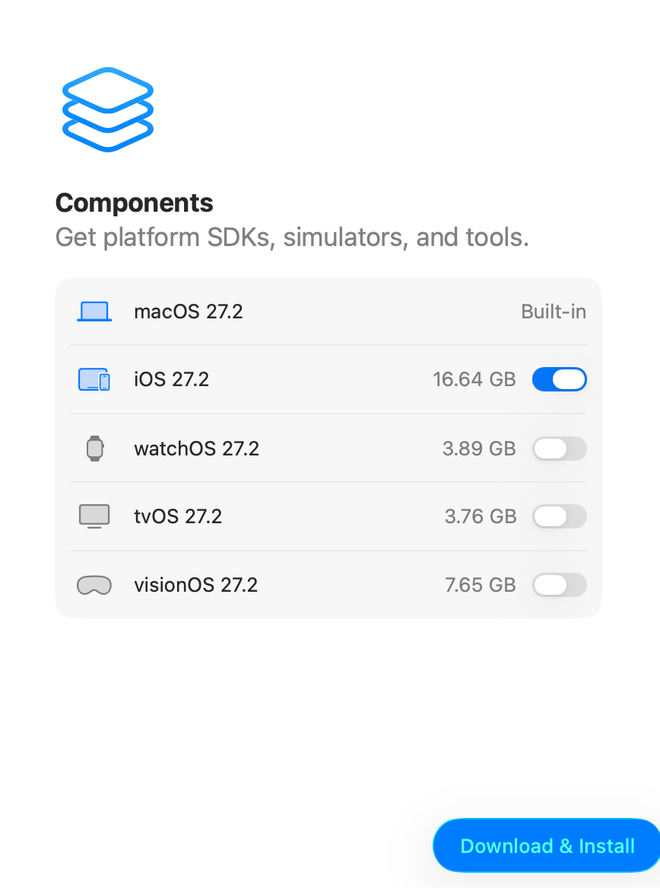
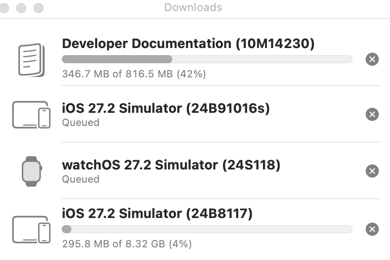
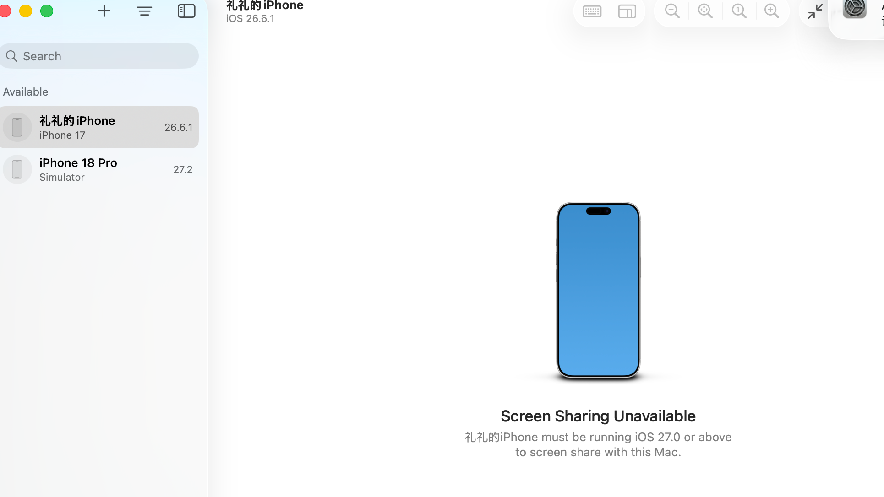

# 从零开发一个 Apple Watch App(一):从裸 Mac 到手腕上的第一次录音

> **系列第 1 篇。** 我在从零开发一个腕上录音 App——手表一键录音、音频自动飞到 iPhone。这是全过程实录:每一次报错、每一次卡壳、每一次深夜想砸键盘,连同解法一起记录。本篇覆盖从"电脑上什么开发环境都没有"到"手表上录出第一段音频、手机上收到"——**环境、工程、签名、真机、闭环,这是任何 Watch App 从零开发都绕不开的第一阶段**。
>
> 前提盘点:一台 Mac(内存硬盘要够,Xcode 全家桶约 40GB)、一只 Apple Watch、一部与手表配对的 iPhone、一根数据线、一个**免费** Apple ID。不需要 688 元/年的开发者账号。
>
> **给纯小白的三个名词**:①**侧载**=不经 App Store,把 App 直接装进自己的设备;②**终端**=Mac 里的命令行工具,按 ⌘空格 搜 "终端/Terminal" 回车即开,把文中代码块粘贴进去回车就行;③下文所有命令,都在克隆下来的 `DayTap/apps/DayTap` 目录里执行(跟着每节开头的 `cd` 走)。
>
> **为什么第一个项目选"录音 App"?** 它不是 Hello World:双端联动(手表+iPhone)、功能真实(录音/传输),代码量却只有 1200 行。工程起点是一个 MIT 开源录音骨架(文末有致谢与链接)——但别以为"有现成代码"就轻松,**让它在你自己的设备上活过来,每一步坑都得亲自踩**,这正是本篇的价值。

**📷 配图总清单(发稿前照单收齐,已入库的标 ✅)**

| # | 内容 | 状态 |
|---|---|---|
| 1 | Xcode 组件选择页(watchOS 要手动开) | ✅ 已入库 |
| 2 | 组件下载进度窗口 | ✅ 已入库 |
| 3 | 终端报错 + `{PRODUCTS}` 那一行 | 📷 补拍 |
| 4 | Device Hub 找不到手表(升级前) | ✅ 已入库 |
| 5 | 手表的开发者模式开关(绿色) | 📷 补拍(手表侧键+表冠同按) |
| 6 | Xcode 选好 Team 的 Signing 页 | 📷 补拍 |
| 7 | 账户证书报错弹窗 | ✅ 已入库(发稿前打码邮箱姓名) |
| 8 | 终端 BUILD SUCCEEDED | 📷 补拍 |
| 9 | iPhone 信任开发者页(VPN与设备管理) | 📷 补拍 |
| 10 | 手表上 DayTap 录音界面(题图候选) | 📷 补拍(手表侧键+表冠同按) |
| 11 | iPhone 上 DayTap 录音列表/分享面板 | 📷 补拍 |
| 12 | 拔线后双设备仍 connected 的终端列表 | 📷 补拍 |
| 13 | Xcode 顶部:scheme/设备选择器/▶ 运行 | 📷 补拍 |
| 14 | 改完代码后手表上显示自己的文案 | 📷 补拍(改法见第九节,改完顺手拍) |

*备用图(未编号):首次启动的 External Agent 弹窗、What's New 页。*

## 一、装 Xcode:第一个坑就在组件选择页

App Store(或 developer.apple.com 下载 .xip)装好 Xcode 后,首次启动会让你选平台组件。页面上 iOS 默认勾着,**watchOS 默认是关的**——如果你不手动打开它,后面根本没法编译手表 App,还得回头补下载。

- ✅ iOS:开(iPhone 配套 App 需要)
- ✅ **watchOS:必须手动打开**(本文主角)
- ❌ tvOS / visionOS:关着,省 11GB



组件装完,Xcode 还有几个首次启动弹窗(外部智能体权限选 *While Xcode is Open* 即可、许可协议 Agree)。



## 二、克隆代码,第一次编译就翻车

```bash
git clone --depth 1 --branch cursor/daytap-watch-app-60a0 https://github.com/flicy/DayTap.git
cd DayTap/apps/DayTap
xcodebuild -project DayTap.xcodeproj -list
```

迎头一棒:

```
xcodebuild: error: Unable to read project 'DayTap.xcodeproj'.
Reason: The project "DayTap" is not a valid property list, and cannot be opened.
```

**"not a valid property list" = 工程文件(project.pbxproj)语法坏了。** 教训:遇到这种错,别怀疑自己,先怀疑仓库——README 里"未真机编译完整验证"这种话,就是在告诉你作者自己也没跑通过。

📷 **[配图3]** 终端报错截图;再加一张在 Xcode 里打开 `project.pbxproj`、⌘F 搜索 `{PRODUCTS}` 定位到那一行的截图(搜不到高亮说明你改对了 😄)
``

定位过程:文件只有 499 行,通读一遍,在 PBXProject 段发现这一行:

```
productRefGroup = {PRODUCTS} /* Products */;   ← 模板占位符没被替换!
```

作者手工写工程文件时留下的坑。plist 解析器把 `{PRODUCTS}` 当成字典开头,直接语法崩。修复:把 `{PRODUCTS}` 换成真正的 Products 组 ID(文件里能搜到,形如 `AA0000000000000000000003`):

```
productRefGroup = AA0000000000000000000003 /* Products */;
```

改完一行,双端编译全部通过:

```bash
xcodebuild -project DayTap.xcodeproj -scheme "DayTap Watch App" -destination 'generic/platform=watchOS Simulator' build
# ** BUILD SUCCEEDED **
```

## 三、改 Bundle ID:给 App 换上你自己的身份

真机安装需要签名,签名用你的 Apple ID。但开源骨架自带的 Bundle ID 是 `com.chriscui.daytap`——这个"身份证号"已被原作者注册,你签不了。换成自己的,比如 `com.你的名字.daytap`。

**要改的地方不止一处**(第二处是我装表时装不上才发现的):

1. `project.pbxproj` 里的 `PRODUCT_BUNDLE_IDENTIFIER`(共 4 处,手机+手表各 2)
2. **手表端 Info.plist 里的 `WKCompanionAppBundleIdentifier`**(声明"我的配套 iPhone App 是谁",漏改的报错见第六节)

## 四、让设备就绪:信任、开发者模式、版本匹配

三部曲,每台设备都要:

1. **信任电脑**:iPhone 插线,弹窗点信任,输密码
2. **开发者模式**:
   - iPhone:设置 → 隐私与安全性 → 开发者模式 → 开 → 重启(⚠️ 这个开关要在 iPhone 被 Xcode 识别过之后才会出现)
   - 手表:同样路径,但它**要等 iPhone 开完之后同步几分钟才冒出来**,别急着说没救了
3. 验证(顺便学一招:**UDID 就是设备身份证号**,后面所有命令都用它指定设备——下面这条命令的 `Identifier` 列就是 UDID,复制保存好):

```bash
xcrun devicectl list devices
# Name            Identifier(=UDID)              State      Model
# 礼礼的iPhone    00008150-XXXXXXXXXXXXXXXX       connected  iPhone 17

xcrun devicectl device info details --device <手机UDID> | grep -i developer
# Developer Mode Status: Enabled ✅
```

**最大的坑在这里**:我的 iPhone 当时是 iOS 26.6,Xcode 是 27.2——Xcode 死活发现不了配对的手表(`xcrun devicectl list devices` 里只有 iPhone)。手表的开发者模式开关也永远不出现。重启手表、重启 iPhone 全没用。**把 iPhone 升到 iOS 27 后,手表立刻出现**。教训:**Xcode、iPhone iOS、watchOS 三个版本要配套,差一个大版本就可能断链**。

```
管宏礼的Apple Watch   available (paired)   Apple Watch Series 11
```



📷 **[配图5]** 手表的 设置 → 隐私与安全性 → 开发者模式 开关页(绿色状态)。拍法:在手表上**同时按一下侧边按钮 + 数码表冠**,截图自动进 iPhone 相册。全文最有"抵达感"的一张。
``

## 五、签名:Team ID 是什么、去哪找

Xcode 里登录 Apple ID(Settings → Accounts → +),然后给两个 target 选 Team。

📷 **[配图6]** Xcode 的 Signing & Capabilities 页,Team 下拉已选中自己 Apple ID 的样子(两个 target 各截一张拼一起更好)。
``

如果你和我一样想全自动,可以命令行试探——**错的 Team ID 会立刻报 "No Account for Team"**,试两次就知道哪个对:

```bash
xcodebuild ... -allowProvisioningUpdates DEVELOPMENT_TEAM=<候选ID> build
```

找自己 Team ID 的邪道:登录后第一次签名,钥匙串里会多一张 Apple Development 证书:

```bash
security find-certificate -c "Apple Development" -p | openssl x509 -noout -subject
# subject=UID=..., CN=Apple Development: xxx@xx.com (XXXX), OU=<这才是TeamID>, ...
```

**注意:证书名字括号里那个不是 Team ID,OU 字段才是**(我试错了两次)。把 Team ID 写进 pbxproj 的 4 个构建配置,一劳永逸。


*(⚠️ 发稿前记得把图里的邮箱和姓名打码)*

📷 **[配图8]** 终端里 `** BUILD SUCCEEDED **` 的截图(绿字那一刻,值得纪念)。
``

免费账号的规则:每人一个"Personal Team",证书限一份、App ID 每周限注册 10 个、**签名 7 天过期**。够玩,别慌。

> ⚠️ **别被老教程带偏**:网上搜"iOS 签名"会看到让你导出 `.p12` 证书文件的教程——**不需要**!现代 Xcode 自动签名全搞定,p12 是十年前(以及第三方签名服务)的流程。而且 p12 里是私钥,等于开发者身份的私章,别导出、别外传。

## 六、编译安装:命令行一把梭

对着真机编译(`-allowProvisioningUpdates` 会自动注册 App ID、生成描述文件):

```bash
# 手表 App → 手表
xcodebuild -project DayTap.xcodeproj -scheme "DayTap Watch App" \
  -destination 'id=<手表UDID>' -allowProvisioningUpdates build

# iPhone App → iPhone(注意:要以 iPhone 为 destination 重新 build 一次,
# 否则描述文件里没登记 iPhone,安装时报 "profile cannot be installed")
xcodebuild -project DayTap.xcodeproj -scheme "DayTap" \
  -destination 'id=<手机UDID>' -allowProvisioningUpdates build
```

安装不需要 Xcode 界面,`devicectl` 直推(产物路径全文展开,别被 `…` 骗了——`DerivedData` 是 Xcode 存编译产物的地方,`DayTap-` 后面那串随机后缀每台电脑不同,用 `ls -d ~/Library/Developer/Xcode/DerivedData/DayTap-*/Build/Products/Debug-watchos/*.app` 找到你自己的):

```bash
# 先看看产物到底在哪(两条都跑,把输出的路径复制下来)
ls -d ~/Library/Developer/Xcode/DerivedData/DayTap-*/Build/Products/Debug-watchos/*.app
ls -d ~/Library/Developer/Xcode/DerivedData/DayTap-*/Build/Products/Debug-iphoneos/*.app

# 安装(把下面的路径换成你上一条命令的输出)
xcrun devicectl device install app --device <手表UDID> ~/Library/Developer/Xcode/DerivedData/DayTap-*/Build/Products/Debug-watchos/DayTap\ Watch\ App.app
xcrun devicectl device install app --device <手机UDID> ~/Library/Developer/Xcode/DerivedData/DayTap-*/Build/Products/Debug-iphoneos/DayTap.app

# 验证
xcrun devicectl device info apps --device <手表UDID> | grep -i daytap
```

装表时报的这个错,就是第三节说的漏改 `WKCompanionAppBundleIdentifier`:

```
This app's bundle identifier does not start with its parent app's bundle identifier
followed by a dot... (MIInstallerErrorDomain error 101)
```

> 💡 **嫌命令行麻烦?Xcode 图形界面同样能走完六、七节**:双击 `DayTap.xcodeproj` 打开工程 → 窗口顶部工具栏选 scheme(`DayTap Watch App`)和运行设备(你的手表)→ 点左上角 ▶ 运行。Xcode 会自动编译、签名、安装、启动,签名问题也会弹窗引导你选 Team。命令行适合脚本化,界面适合探索,两条路都要会。

📷 **[配图13]** Xcode 顶部工具栏:scheme 选择器 + 设备选择器 + ▶ 运行按钮的位置。
``

## 七、首跑:信任开发者 + 一个会顶掉 App 的系统机制

1. **双端都要手动信任**:iPhone 和手表上,设置 → 通用 → VPN与设备管理 → 信任你的开发者证书,App 才能打开

📷 **[配图9]** iPhone 的 设置 → 通用 → VPN与设备管理 → 开发者App 信任页(普通手机截图)。
``

2. **玄学事件**:装好的手表 App 突然消失了。原因:iPhone 上打开主 App 后,系统的 Watch App 会尝试用它内嵌的手表版走官方渠道重装,对免费签名证书这个流程会卡死,还会顶掉原来装好的。**解法:无视它,`devicectl` 直接重推一次**,完事

## 八、验证闭环:手腕 → 手机 → 电脑

完整流程:手表打开 DayTap → 允许麦克风 → 按录音 → 说话 → 停止 → 几秒后 iPhone 的 DayTap 列表出现 m4a → 分享到 Mac:

```
大小: 121 KB
时长: 15.18 sec
码率: 47.6 kbps  ← 和代码里写的 48kbps 分毫不差
```

📷 **[配图10] 全文高光/题图候选**:手表上 DayTap 的录音界面(计时中)。拍法:侧键+表冠同按,截图进 iPhone 相册。
``

📷 **[配图11]** iPhone 上 DayTap 列表里出现那条录音 / 点开后的分享面板。
``

**乌龙一则**:第一次录音传过来只有 28 字节(纯文件头,零音频数据)。排查发现不是 bug——抬腕后点录音几乎立刻停了,0 秒录音就是空壳。重录一次,15 秒真音频到手。

## 九、毕业考:改下第一行代码,从安装者变成开发者

装好别人的 App 只是"会侧载";**改一行代码并看到它出现在自己手腕上,才算入门 iOS 开发**。两个改法,从零风险到初尝代码:

**改法 A(零风险):给 App 改名**

用任意文本编辑器打开 `DayTapWatch/Info.plist`,找到:

```xml
<key>CFBundleDisplayName</key>
<string>DayTap</string>
```

把 `DayTap` 改成你想起的名字(手机端的 `DayTap/Info.plist` 里同样一处)。

**改法 B(真正的源码):改手表上的提示文案**

打开 `DayTapWatch/WatchLink.swift`,第 17 行附近有一行 Swift 代码:

```swift
private(set) var statusText = "结束后会传给 iPhone"
```

把引号里的字改成任何你想说的话,比如 `"录音将飞往 手机"`。

**然后重装**:重复第六节那两条 `xcodebuild` + 两条 `devicectl install` 命令(增量编译只花十几秒),抬腕打开 App——**你的名字、你的文案,跑在你的手表上**。

这就是 iOS 开发的最小循环:**改 → 编 → 装 → 看**。之后所有 SwiftUI 开发,无论多复杂,都是这个循环的重复。

📷 **[配图14]** 改完后手表上显示你自己文案的截图(和配图10 同款拍法)——你的第一行代码上腕了。
``

## 十、这趟旅程,你其实已经学会了这些

回头看,每一步踩的坑背后,都是一个正经的 iOS 开发知识点:

| 你踩过的坑 / 做过的事 | 背后的知识(面试都问这个) |
|---|---|
| 修 pbxproj、认 scheme 名字 | **Xcode 工程结构**:.xcodeproj / target / scheme 各管什么 |
| 组件页勾 watchOS | **SDK 与平台**:编译哪个平台的 App 就要哪个平台的 SDK |
| 模拟器能编译、真机才能传文件 | **模拟器 vs 真机**:UI 开发用模拟器,蓝牙/传感器/WatchConnectivity 必须真机 |
| 改 Bundle ID(两处) | **App 身份体系**:Bundle ID 是 App 的身份证,配套 App 的 ID 必须是主 App 前缀 |
| 找 Team ID、签名、描述文件 | **iOS 代码签名四件套**:Apple ID → 团队 → 证书(私钥)→ 描述文件(谁+哪台设备+哪个App) |
| 开开发者模式 | iOS 16 起真机调试的总闸,防普通用户被恶意调试 |
| UDID + devicectl 命令 | **设备管理与 CLI 工具链**:不用开 Xcode 也能装 App、查状态 |
| 手动"信任开发者" | **分发体系**:App Store / TestFlight / 开发者证书直装的区别 |
| 找 DerivedData 里的 .app | **构建产物**:编译输出在哪、Debug 和 Release 差异 |
| 7 天过期 | **免费 vs 付费开发者账号**的能力差异 |
| 读这个项目的源码 | 两个核心框架:**AVAudioRecorder**(录音)、**WatchConnectivity**(表↔手机通信) |

想读懂这个项目的源码,推荐顺序:`RecordingScreen.swift`(界面)→ `WatchModel.swift`(状态逻辑)→ `AudioCapture.swift`(录音)→ `WatchLink.swift`(传输)。每个文件都有中文注释,是难得的中文 watchOS 学习材料。

## 十一、坑速查表(本文精华,建议收藏)

| 报错/现象 | 原因 | 解法 |
|---|---|---|
| project is not a valid property list | pbxproj 语法坏(这个仓库是模板占位符) | 通读 pbxproj 找异常行;`{PRODUCTS}` → 真实组 ID |
| 组件选择页没勾 watchOS | 默认关 | 必须手动开,否则编译不了手表 App |
| 手表永远不出现在设备列表 | iOS 与 Xcode 版本差一个大版本 | 升级 iPhone 系统到配套版本 |
| 手表设置里没有开发者模式 | iPhone 的开关没同步过去 | iPhone 先开好+插线,手表解锁等待/重启,几分钟内出现 |
| No Account for Team "XXX" | Team ID 填错 | 用 xcodebuild 试探;证书 OU 字段才是真 Team ID |
| profile cannot be installed on this device | 描述文件没登记这台设备 | 以该设备为 destination 重新 build |
| MIInstallerErrorDomain error 101 | 手表 Info.plist 配套声明没改 | WKCompanionAppBundleIdentifier 同步改 |
| 不受信任的开发者 | 免费证书需手动信任 | 设置→通用→VPN与设备管理→信任(双端各一次) |
| 手表 App 神秘消失 | 系统 Watch App 重装机制卡死顶掉了 | devicectl 直接重推 |
| 录音文件 28 字节 | 0 秒录音(立刻停了) | 重录,注意抬腕保持 App 前台 |
| 拔线后 iPhone 变 unavailable | Mac 走有线、手机走 5G,不在同一局域网 | iPhone 连上 Mac 所在局域网的 Wi-Fi,保持解锁 1~2 分钟 |
| 网上教程让你导 .p12 证书 | 过时流程(第三方签名服务那套) | 不需要!Xcode 自动签名全搞定;p12 含私钥勿外传 |
| 7 天后 App 打不开 | 免费证书过期 | 插线,重复第六节两条命令 |

## 十二、Bonus:后续开发可以不插线

老教程会教你开"Connect via Network"勾选框——**Xcode 27 里没有这个开关了**,无线发现是全自动的。条件只有一条:**Mac、iPhone、手表在同一局域网**。

我踩的最后一个坑:拔线后 iPhone 直接从设备列表消失。排查发现 Mac 走的有线、iPhone 走的 5G,俩设备根本不在一个网络里。手机连上家里 Wi-Fi 后一分钟,iPhone、手表全部自动回到列表——`connected` 状态,编译安装照常。

📷 **[配图12]** 拔线状态下,终端 `devicectl list devices` 显示 iPhone 和手表都还是 connected 的截图——无线自由的证据。
``

日常无线开发的规矩:手机连着这个 Wi-Fi、别锁屏太久;系统大版本升级、证书重签、无线抽风时,把线插回来最稳。

## 十三、下一篇:这个 App 还缺什么

第 1 篇到此为止:App 已经活在我自己手腕上了。但离"真的好用"还有距离——以下就是本系列接下来的篇目,也是我真实的开发计划:

- **(二)解放手腕**:现在手腕一放、屏幕一灭,录音就断。用 `audioRecording` 后台模式让录音在熄屏后继续——一节 45 分钟的课,装得下
- **(三)录得安心**:录音时屏幕保持常亮 + 开始/停止时触觉轻震确认
- **(四)手腕上回听**:录音列表直接在表上播放,不用掏手机
- **(五)录音自动落到 Mac**:iPhone 收到音频自动同步进电脑文件夹,接上转写和归档,变成真正的"腕上日录"系统

你会发现,每一篇做的都是同一件事:**改 → 编 → 装 → 看**。会了这个循环,你就已经是 iOS 开发者了,区别只是熟练度。

**想系统学,按这个顺序**:Swift Playgrounds(官方免费,像玩游戏)→ Apple 官方 SwiftUI 教程 → 100 Days of SwiftUI(免费经典)→ 斯坦福 CS193p。但最好的练习场永远是:回到你的工程,把第九节的改法玩出花——加个按钮、改个颜色、调个字号,每个改动都是一课。

---

**起点与致谢**:本工程以 MIT 开源录音骨架 [flicy/DayTap](https://github.com/flicy/DayTap) 起步,在其基础上修复工程缺陷(见第二节、第三节)并进行二次开发。感谢作者开源——虽然他自己的真机闭环也没跑通 😄,但代码骨架是认真的,这就是开源的意义。

*环境:Mac (Apple Silicon, macOS 26) / Xcode 27.2 / iPhone 17 (iOS 27) / Apple Watch Series 11 (watchOS 26.6) / 免费 Apple ID*
*本系列与 ZCode 全程结对开发 🤝*
